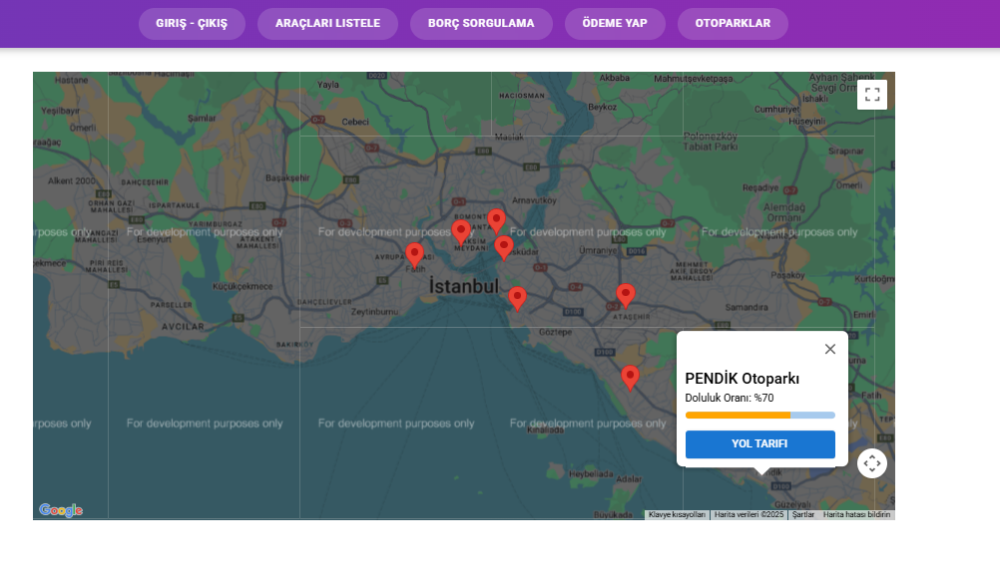

# Otopark Yönetim Sistemi

**Spring Boot REST API ve React arayüzüyle geliştirilen staj projesi.** Araçların otoparka giriş ve çıkışını kaydeder, park süresinden ücret hesaplar, plaka üzerinden borç sorgular ve ödeme durumunu takip eder.

> English: A full-stack parking management internship project with a Java/Spring Boot API, SQL Server persistence and a React/Material UI frontend.

## Özellikler

- Plaka ile araç girişi ve çıkışı; aktif giriş varken tekrar girişi engelleme.
- Saatlik ücret üzerinden park bedeli hesaplama (örnek tarife: 150 TL).
- Araç listesi, giriş/çıkış kayıtları ve plaka bazlı borç sorgulama.
- Borcun ödendi olarak işaretlenmesi ve isteğe bağlı SMTP bilgilendirmesi.
- Google Maps üzerinde örnek otopark konumları, doluluk oranları ve yol tarifi.
- Swagger/OpenAPI ile API keşfi ve dosyaya günlük yazma.

## Ekran görüntüsü



Orijinal staj çalışmasından ekran görüntüsüdür. Harita ve doluluk verileri örnektir; görüntüde geliştirme ortamına ait Google Maps uyarısı bulunur.

## Teknolojiler

| Katman | Teknoloji |
| --- | --- |
| Backend | Java 21, Spring Boot 3.5.5, Spring Data JPA, Spring Mail |
| Veritabanı | Microsoft SQL Server |
| Frontend | React 19, Material UI, React Router, Axios, React Toastify |
| Harita | Google Maps JavaScript API |
| Araçlar | Maven Wrapper, npm, OpenAPI/Swagger |

## Mimari

```text
React ekranları → Axios / REST → Controller → Service → Repository → SQL Server
                                      └── SMTP (isteğe bağlı)
```

## Çalıştırma

Java 21, Node.js/npm ve yerel SQL Server gerekir. Google Maps anahtarı yalnızca harita ekranı için gereklidir.

### Backend

1. SQL Server'da `OtoparkDB` adında boş bir veritabanı oluşturun.
2. PowerShell'de bağlantı değişkenlerini kendi ortamınıza göre ayarlayın:

```powershell
$env:DB_URL='jdbc:sqlserver://localhost:1433;databaseName=OtoparkDB;encrypt=true;trustServerCertificate=true'
$env:DB_USERNAME='YEREL_KULLANICI'
$env:DB_PASSWORD='YEREL_SIFRENIZ'
cd otoparkprojesi
.\mvnw.cmd spring-boot:run
```

Yayın kopyasında JPA `update` ayarı yerel demo için tabloları oluşturur. Bu ayar mevcut bir üretim veritabanı için tasarlanmamıştır. API varsayılan olarak `http://localhost:8080` adresindedir.

### Frontend

Başka bir terminalde:

```powershell
cd otoparkprojefronted
Copy-Item .env.example .env
npm ci
npm start
```

Arayüz `http://localhost:3000` adresinde açılır. Harita ekranı için `.env` dosyasındaki `REACT_APP_GOOGLE_MAPS_API_KEY` alanına kendi anahtarınızı yazın; anahtarı alan adıyla sınırlandırın.

### İsteğe bağlı e-posta

Backend'i başlatmadan önce `MAIL_USERNAME` ve `MAIL_PASSWORD` ortam değişkenlerini tanımlayabilirsiniz. SMTP parolası boşken yayın kopyası e-posta gönderimini atlar; ödeme kaydı demo olarak denenebilir. E-posta alıcısı kaynak kodda `demo@example.com` örnek adresidir; gerçek gönderim için yerel test adresinizle değiştirin. Arayüzdeki mail başarı metni teslimat doğrulaması değildir.

## API örnekleri

| Yöntem | Yol | İşlem |
| --- | --- | --- |
| POST | `/api/vehicles/entry?plateNo=DEMO001` | Araç girişi |
| PUT | `/api/vehicles/exit?plateNo=DEMO001` | Araç çıkışı ve ücret |
| GET | `/api/vehicles/debt?plateNo=DEMO001` | Borç sorgulama |
| POST | `/api/vehicles/pay?plateNo=DEMO001` | Ödendi kaydı |
| GET | `/api/vehicles` | Araç listesi |
| GET | `/api/vehicles/entry-vehicles` | Giriş kayıtları |
| GET | `/api/vehicles/exit-vehicles` | Çıkış kayıtları |

Swagger arayüzü: `http://localhost:8080/swagger-ui/index.html`.

## Depo yapısı

| Klasör | İçerik |
| --- | --- |
| `otoparkprojesi/` | Ana otopark REST API'si |
| `otoparkprojefronted/` | Ana React arayüzü |
| `HGSProje/` | Stajda geliştirilen ek geçiş/ödeme ve kimlik doğrulama denemeleri |
| `KitapProje/Book/` | Ek kitap/ödünç yönetimi API çalışması |
| `SprinTicketProject/` | Ek etkinlik, koltuk ve bilet rezervasyonu çalışmaları |

Ek klasörler ayrı uygulamalardır; otoparkı çalıştırmak için gerekli değildir. Kendi `pom.xml`/`package.json` dosyaları ve veritabanı gereksinimleri bulunur. Hassas yapılandırmalar ortam değişkenlerine taşınmıştır (`DB_URL`, `DB_USERNAME`, `DB_PASSWORD`, gerektiğinde `JWT_SECRET` ve `DEMO_ADMIN_PASSWORD`). Bu ek denemelerin tamamı için çalışır uygulama doğrulaması yapılmamıştır.

## Kapsam

Ödeme akışı veritabanında durum değiştirir; banka veya ödeme sağlayıcısı entegrasyonu yoktur. Otopark doluluk oranları sabit örnek verilerdir. Ana API için kullanıcı yetkilendirmesi eklenmemiştir. Proje eğitim/staj çalışmasını ve katmanlı uygulama geliştirme yaklaşımını gösterir.

**Geliştirici:** [Beraterd](https://github.com/Beraterd)

## Doğrulama

Ana Java API'si `mvnw.cmd -DskipTests compile`, React arayüzü `npm ci` ve `npm run build` ile derlendi. Yerel SQL Server ve SMTP ile uçtan uca çalışma kontrolü yapılmadı. Create React App tabanlı mevcut bağımlılıklar eski paketler ve güvenlik uyarıları içeriyor; çalışma eğitim demosu olarak sunulmaktadır.
